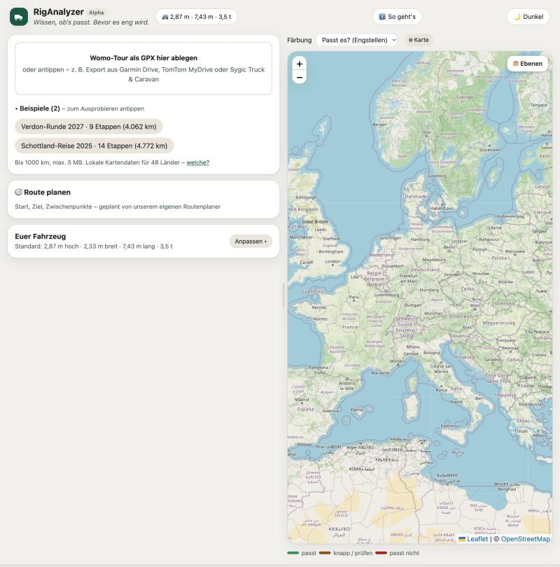
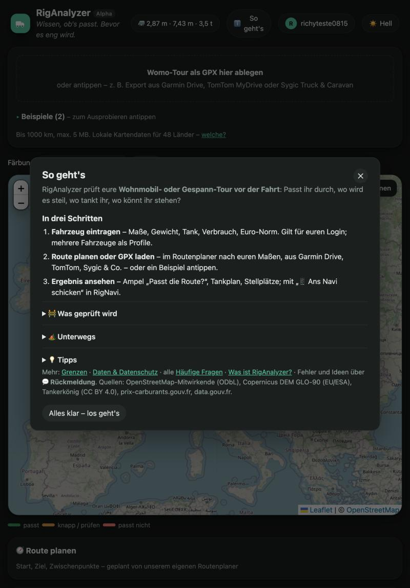
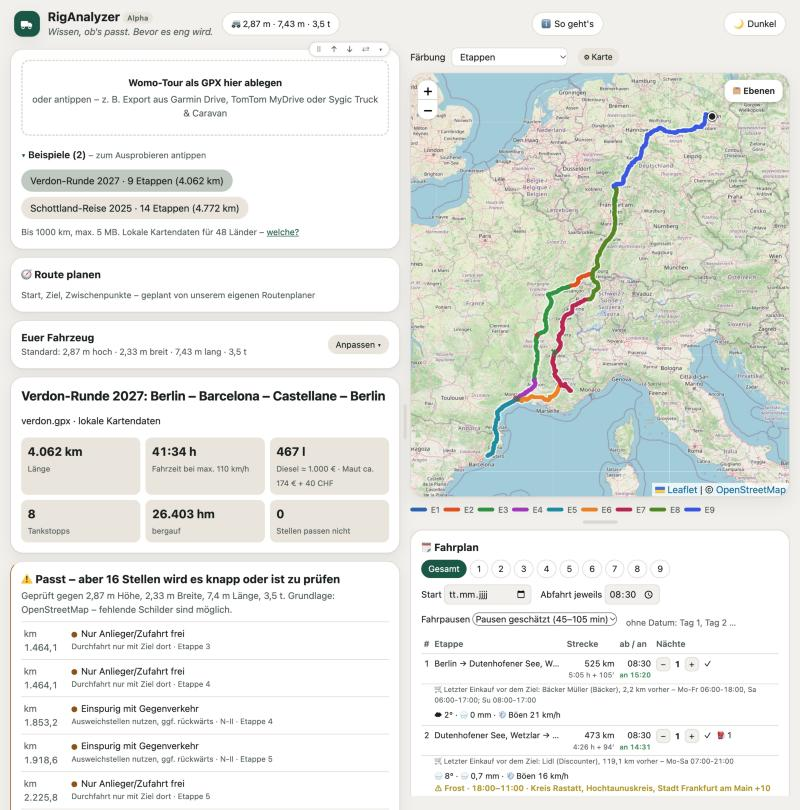
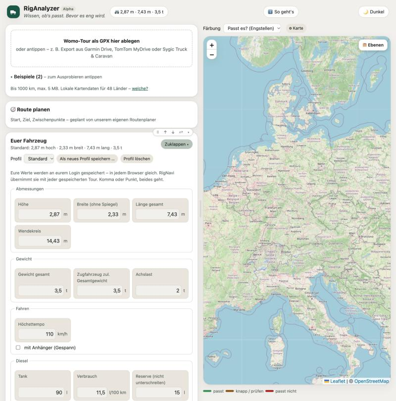
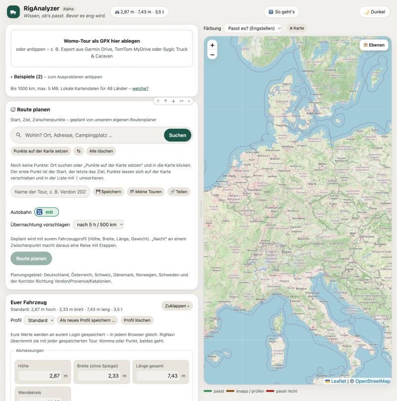
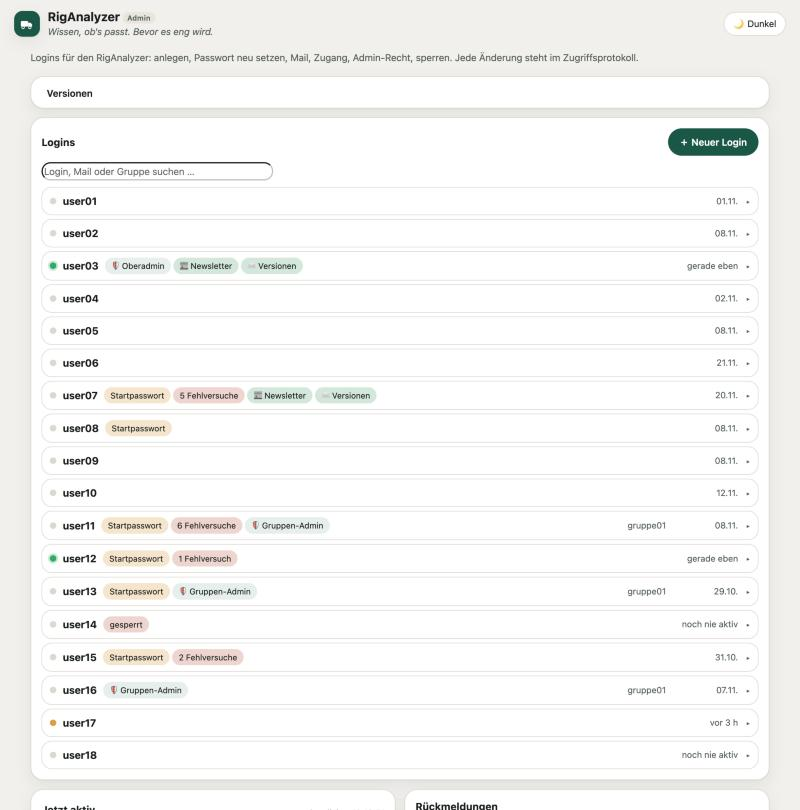

<p align="center">
  
</p>

<h1 align="center">RigAnalyzer <sup>& RideAnalyzer</sup></h1>

<p align="center">
  <b>GPX hochladen &nbsp;→&nbsp; Tour bewerten, <i>bevor</i> du losfährst.</b><br>
  <i>Wissen, ob's passt. Bevor es eng wird.</i>
</p>

<p align="center">
  <a href="LICENSE"></a>
  
  
  
  
</p>

---

## 🧭 Worum geht's?

**RigAnalyzer** (🚐 Wohnmobil &amp; Gespann) und **RideAnalyzer** (🏍️ Motorrad) sind zwei Oberflächen desselben Dienstes. Du lädst eine **GPX-Route** hoch, der Dienst legt sie auf OpenStreetMap, sammelt Ereignisse, Kurven, Ortsdurchfahrten, Landschaft und Sehenswertes ein – und gibt dir eine **Bewertung nach Fahrerprofil**, bevor du den Motor startest.

> Ein Dienst, eine Oberfläche pro Domain: `static/` (Ride) bzw. `static-rig/` (Rig). Die Rig-Auswertung liegt in `app/rig.py`, Höhendaten aus Copernicus-DEM in `app/dem.py` (Kacheln nach `data/dem/`).

<p align="center">
  
</p>

---

## ✨ Features

|   | RigAnalyzer 🚐 | RideAnalyzer 🏍️ |
|---|---|---|
| **GPX-Upload &amp; Analyse** | ✅ | ✅ |
| **Bewertung nach Fahrerprofil** | P1–P4 | P1–P4 |
| **Fahrfluss, Kurven, Ortsanteil** | ✅ | ✅ |
| **Belag, Landschaft, Sehenswertes, Pausen** | ✅ | ✅ |
| **Höhendaten aus Copernicus-DEM** | ✅ | ✅ |
| **500-m-Abschnitte mit Achsen-Scores** | ✅ | ✅ |
| **Rig-spezifische Auswertung (`app/rig.py`)** | ✅ | – |
| **Eigener Routenplaner (3,5-t-freundlich)** | ✅ | – |
| **Fahrzeugprofile (Maße, Gewicht, Tank)** | ✅ | – |
| **Hinweise: Schlenker &amp; kurvige Passagen** | – | ✅ |
| **Dark &amp; Light Mode** | ✅ | ✅ |

**Fahrerprofile:** P1 Solo · P2 kleine Gruppe · P3 Gruppe · P4 Idee

---

## 📸 Tour-Analyse im Detail

Beispiel: **Verdon-Runde 2027** (Berlin → Barcelona → Castellane → Berlin, 9 Etappen, 4.062 km). Links die Kennzahlen und Warnungen, rechts die Etappen auf der Karte, unten der Fahrplan mit Einkaufsstopps, Wetter und Pausen.

<p align="center">
  
</p>

**Was pro Tour geprüft wird (Auszug aus der echten Analyse):**

- 🛣️ Länge, Fahrzeit bei max. 110 km/h, Höhenmeter
- ⛽ Dieselverbrauch &amp; Maut-Kalkulation, Zahl der Tankstopps
- ⚠️ *„Passt – aber N Stellen wird es knapp oder ist zu prüfen"* – kilometergenaue Hinweise (z. B. „Nur Anlieger/Zufahrt frei", „Einspurig mit Gegenverkehr")
- 🗺️ Etappen E1…En mit eigener Farbe auf Leaflet-Karte
- 📋 Fahrplan: Letzter Einkauf vor dem Ziel, Nächte, Pausen (Vorschlag 45–105 min), Wetter mit Böen und Frostwarnung

---

## 🧰 Fahrzeugprofil

Jeder Login speichert ein oder mehrere Fahrzeugprofile mit **Abmessungen, Gewicht, Tank und Verbrauch**. Der Routenplaner und die Analyse rechnen damit automatisch – inklusive **Gespann-Modus** mit Anhänger.

<p align="center">
  
</p>

---

## 🗺️ Eigener Routenplaner

Statt eine fertige GPX hochzuladen, kannst du Start, Ziel und Zwischenpunkte direkt im Browser setzen. Der Planer berücksichtigt **Autobahn-Toggle, Umweltzonen, Maut, Fähren** und schlägt Übernachtungen nach `5 h / 500 km` vor.

<p align="center">
  
</p>

**Planungsgebiet:** Deutschland, Österreich, Schweiz, Dänemark, Norwegen, Schweden sowie der Korridor Richtung Verdon / Provence / Katalonien.

---

## 🔍 Wie die Analyse funktioniert

```
GPX  →  10-m-Raster  →  Map-Matching auf OSM
                           ├─ Ereignisse: Ampeln, Vorfahrt, Kreisel, Bahnübergänge, Abbiegen
                           ├─ Kurven über Krümmung (Abbiegen/Kreisel gefiltert, Spitzkehren eigene Klasse,
                           │  Kurven auf holprigem/schmalem Belag zählen halb)
                           ├─ Ortsdurchfahrten
                           ├─ Landschaft links/rechts
                           ├─ POIs mit Fahrzeit
                           └─ 500-m-Abschnitte mit Achsen-Scores
```

**Hinweise, die der Dienst erkennt:**

- 🌀 **Schlenker** – Bundes-/Landesstraße kurz verlassen und zurück (z. B. „Gröfelhof").
- 🪝 **Kurvige Passagen mit Haken** – z. B. „Eggeralm".

---

## 🗺️ Datenquellen

1. **Lokale OSM-DBs** – je Region eine Datei `data/osm/<region>.sqlite` (SQLite + R-Tree), gebaut aus Geofabrik-Extrakten (`rideanalyzer_osm_regions` in `plan-regionen.yml`).
   Der Container baut fehlende/fällige Regionen selbst (`build_db.py`, `nice 10`, Knoten-Index als Datei), Region für Region und jeweils **atomar**. Ein Container-Neustart kostet höchstens die gerade laufende Region; fertige Regionen sind sofort nutzbar und werden nicht neu gebaut. Neubau nach 30 Tagen.
   Status: `GET /api/info` (`osm_building`, `osm_pending`, `osm_error`).
2. **Overpass-API** als Rückfall für Teilstücke außerhalb der DB-Gebiete (je ≈20 km, Cache in `data/cache`, 14 Tage). Öffentliche Instanzen sind unter Last unzuverlässig (502/leere Antworten) – leere Antworten werden **nicht** gecacht.

> Die alte Sammel-DB `data/osm.sqlite` (v0.1) wird weiter genutzt, bis sie fällig ist, und gelöscht, sobald alle Regionen eigene Dateien haben.

Weitere Quellen: Copernicus DEM GLO-90 (EU/ESA), Tankerkönig (CC BY 4.0), prix-carburants.gouv.fr, data.gouv.fr.

---

## 🚀 Schnellstart (lokal)

**Tests:**

```bash
python -m pytest -q tests && node --test tests/js/*.cjs
```

**App von Hand starten (aus `app/`):**

```bash
OSM_AUTOBUILD=0 \
OSM_DB=/pfad/osm.sqlite \
CACHE_DIR=/tmp/c \
uvicorn main:app --port 8765

# http://127.0.0.1:8765/?demo=barnim lädt die Beispieltour
```

**Betrieb in Produktion:** Container `rideanalyzer` (uvicorn :8000) hinter einem Reverse-Proxy.

---

## 👤 Registrierung &amp; Admin

Logins liegen in `data/users.json` (Verwaltung im Admin-Bereich `/admin` oder `users.py`).
Seit **v0.20.0** kann man sich unter `/registrieren` selbst eintragen (Link auf der Anmeldeseite):

- Der Login bekommt die App der Domain und bleibt gesperrt (`pending`).
- Die Oberadmins sehen den Pending-Login unter `/admin` und schalten ihn mit **✅ Freischalten** frei (Nutzer bekommt eine Mail) – oder löschen ihn.
- Ohne Mail-Versand: `docker exec rideanalyzer python users.py frei NAME`.

<p align="center">
  
</p>

Pro Login gibt es Status-Badges: `Oberadmin`, `Gruppen-Admin`, `Startpasswort`, `N Fehlversuche`, `Newsletter`, `Versionen`, `gesperrt`. Gruppen wie `riders_only_*` erlauben geteilte Touren.

---

## 📜 Lizenz

Copyright © 2026 Richard Petrick

Dieses Programm ist freie Software unter der **GNU Affero General Public License v3.0** ([`LICENSE`](LICENSE), SPDX `AGPL-3.0-only`). Du darfst es nutzen, ändern und weitergeben – auch kommerziell. Bedingungen:

- Copyright- und Lizenzhinweise bleiben erhalten (Quelle nennen).
- Wer eine geänderte Fassung weitergibt **oder als Webdienst betreibt**, stellt den vollständigen Quellcode unter derselben Lizenz bereit.

Fremde Bestandteile behalten ihre eigene Lizenz, siehe [`THIRD-PARTY.md`](THIRD-PARTY.md). Andere Lizenzbedingungen (z. B. für eine geschlossene kommerzielle Nutzung) nur nach Absprache.

---

## 🤝 Mitmachen

Fehlermeldungen und Vorschläge gern als **Issue**.
Pull-Requests werden nur mit unterschriebenem **Contributor License Agreement (CLA)** angenommen – damit das Projekt seine Lizenz später selbst anpassen kann.

---

<p align="center">
  <sub>Made with ☕, 🚐 und OpenStreetMap-Mitwirkenden (ODbL).</sub>
</p>
